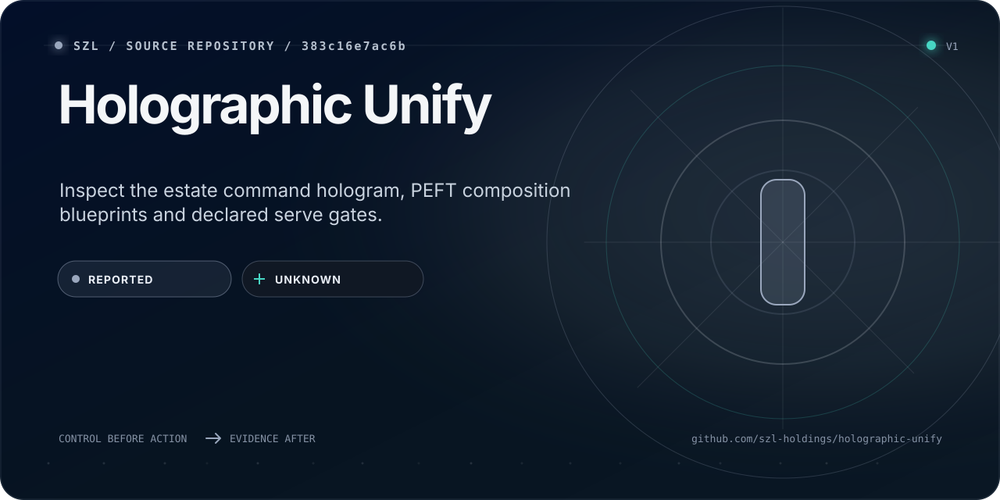

<!-- Native identity: szl-brand@4309f6fce89179331b0b3ed8c99494e76c5be256; Orbit v2 icon sha256 6e2b7d72a3af3d9602b79de41df0194ede6496a9661f057108ec224c0efc92e6. -->
<!-- Surface Foundry: szl-brand@b519affbd63447c086cb74b6e0636661bcac09a6; input README.surface.json; receipt README.surface-receipt.json. Generation metadata is not live runtime evidence. -->
<p><a href="https://github.com/szl-holdings"></a></p>

<!-- SZL-SURFACE-CARD:v3:START -->
<p align="center">
  <a href="https://github.com/szl-holdings/holographic-unify">
    
  </a>
</p>

> Inspect the estate command hologram, PEFT composition blueprints and declared serve gates.

| Path | What a non-technical reader gets | Where a builder starts |
| --- | --- | --- |
| **Understand** | Understand the hologram's purpose and the boundary between a blueprint and a trained artifact. | [Open the primary surface](https://github.com/szl-holdings/holographic-unify) |
| **Build** | Start with canonical GitHub source and the separately owned Space package. | [Inspect source](https://github.com/szl-holdings/holographic-unify) |
| **Verify** | `REPORTED` evidence · `UNKNOWN` runtime | [Inspect evidence](https://github.com/szl-holdings/holographic-unify/blob/cf3925ab1c9b78fccf5780d2098eea0864afb33b/README.md) |

<sub>Source presentation; current Hub runtime requires publisher readback. PEFT composition is not training. Signatures remain UNSIGNED-honest, energy UNAVAILABLE and Λ Conjecture 1. A signature proves scoped integrity and origin; it does not prove accuracy, safety, performance, compliance, or authorization.</sub>
<!-- SZL-SURFACE-CARD:v3:END -->


<details>
<summary>Visual source and reproduction</summary>

This card is generated by [SZL Surface Foundry](https://github.com/szl-holdings/szl-brand/tree/b519affbd63447c086cb74b6e0636661bcac09a6) from [the reviewed source contract](https://github.com/szl-holdings/holographic-unify/blob/main/README.surface.json). [The generation receipt](https://github.com/szl-holdings/holographic-unify/blob/main/README.surface-receipt.json) binds its copy and SVG; it does not attest live publication or independent product verification.

At that exact brand revision, run `PYTHONPATH=src python -m szl_brand.surface /path/to/README.surface.json --output /tmp/szl-readme-card`. Copy the generated SVG to `readme-surface-card.svg` and the receipt to `README.surface-receipt.json`; update only the v3 managed block and preserve the surrounding source bytes.

Native SZL artwork is reused from its [licensed source](https://github.com/szl-holdings/szl-brand/blob/4309f6fce89179331b0b3ed8c99494e76c5be256/NOTICE) with CC BY 4.0 attribution to SZL Holdings and the source trademark reservation.

</details>

# SZL Holographic Unify

Estate command hologram. **Wave 2026 admitted. PEFT on Forge. Gate on Serve.**
Λ uniqueness is **Conjecture 1**. This is **not** [a-11-oy.com](https://a-11-oy.com), **not** the a11oy flagship, **not** an ATO.

GitHub is canonical source. Hugging Face is the artifact registry, not the front door.
Hub RUNNING is claimed only after `scripts/publish_space.py --apply` returns
provider metadata and a successful `/healthz` readback. It runs only inside the
committed workflow `.github/workflows/deploy-hf-space.yml` (push to `main` or
manual dispatch), which holds the one publisher secret; a local `--apply` is refused.
**Do not `npm ci` on Hub.** Flatten payload is `space/` (stdlib HTTP, GCR Python).

| Surface | State |
| --- | --- |
| GitHub | [szl-holdings/holographic-unify](https://github.com/szl-holdings/holographic-unify) · public |
| Hugging Face Space | `SZLHOLDINGS/holographic-unify` · Docker hologram · **RUNNING only after Hub readback** |
| Live command | Grok App Builder preview · xAI gate hologram, not Khipu weights |
| Canonical flagship | [szl-holdings/a11oy](https://github.com/szl-holdings/a11oy) |
| Product | [a-11-oy.com](https://a-11-oy.com) · **not certified** |
| Proof | [a11oy.net](https://a11oy.net) |
| Never | `a11oy.com` |

## What this hologram is

- **Evolve** — Keep-pushing loop over Wave 2026. Doctrine board is 16 admitted / 2 floors / 1 roadmap. **Finish this loop** stamps the board and one Ayllu lock. Keep pushing walks one seat. K3 / Qwen-Max dumps REFUSED. Nemotron GPU ROADMAP.
- **Forge** — PEFT kit (LoRA / QLoRA / DoRA / rsLoRA / IA³). Composes a cut receipt. Does **not** train.
- **Serve** — vLLM **job** hologram. PagedAttention page table. Tokens + elapsed_ms. No invented tok/s.
- Pinned GGUF `SZLHOLDINGS/SZL-Khipu-1.5B-GGUF@67d60ec…` SHA-256 `13c1a199…`. MEASURED CPU lab 21 tok / 2053 ms on 2026-08-28.

## What it is not

- Not a rehost of Flux, K3, V4-Pro, K2.7, GLM, Qwen, Llama 4, Gemma 4, gpt-oss, or Inkling weights.
- Kimi-K3 dump is **REFUSED**. Inkling 975B host is **REFUSED**. Qwen 2.4T Max dump is **REFUSED**.
- GPU Unsloth / vLLM CUDA remain **ROADMAP**.
- Energy joules stay **UNAVAILABLE** unless NVML MEASURED.
- Signatures stay **UNSIGNED-honest**. No fake DSSE.
- `proven_trust` is always false.

## Honesty

| Claim | Status |
| --- | --- |
| Command hologram | LIVE in Grok App Builder |
| PEFT compose | HOLOGRAM · BLUEPRINT_NOT_TRAINED until keyed |
| xAI gate | grok-4.7 (rollback: grok-4.5) · labelled not-Khipu-weights |
| GPU vLLM / Unsloth | ROADMAP |
| Energy joule | UNAVAILABLE |
| Λ uniqueness | Conjecture 1 |
| proven_trust | false |
| K3 rehost | REFUSED |

## Hub runtime

Flatten payload is `space/` (the publisher uploads those files to Space root).
Stdlib HTTP on 7860. No npm.

| Path | Honesty |
| --- | --- |
| `GET /` | hologram card · Wave 2026 / Forge / Serve |
| `GET /healthz` | JSON honesty · GPU ROADMAP · joules UNAVAILABLE |
| `GET /api/honesty` | same payload |
| `HEAD /` | 200 |

## Run

Inspect the source here. The live command surface is the Grok App Builder preview.
Hub is the Python flatten only.

```bash
# Validate source and runtime contract without credentials.
python3 -I -B scripts/verify_space.py

# Preview the exact source-bound publication plan (dry run, no provider calls).
python3 -I -B scripts/publish_space.py

# Publish: only the committed workflow may apply it.
gh workflow run deploy-hf-space.yml -R szl-holdings/holographic-unify --ref main

# Run the Hub flatten directly.
python space/server.py
```

Auth and database stay off. Completions on the live surface use the server
`XAI_API_KEY` when present, user-initiated, capped. Without a key, the gate
fails closed — it does not mock.

The gate model is `DEFAULT_GROK_MODEL` (`grok-4.7`) in `src/lib/grok-contract.ts`.
The server-side `SZL_GROK_MODEL` may select only an id in `ALLOWED_GROK_MODELS`
(`grok-4.7`, or `grok-4.5` as the single rollback target); blank uses the default.
Any other value fails closed as `Gate UNAVAILABLE` with no provider request. It
never falls back to the default. Adding an id to the allowlist is a model change
and needs its own review.

Apache-2.0 · Doctrine v11 LOCKED · Copyright 2026 SZL Holdings.
